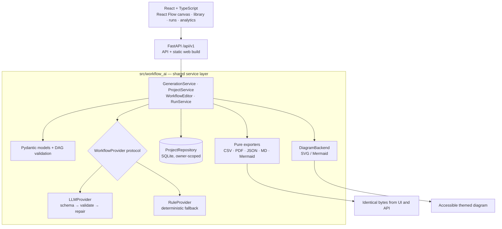

<h1 align="center">🤖 AI-Driven Dynamic Workflow Generator</h1>
<h3 align="center">Transform Natural Language into Structured Workflows 🚀</h3>

<p align="center">
  
  
  
  
  
  
</p>

---

## 📌 Overview

The **AI-Driven Dynamic Workflow Generator** converts natural language descriptions and uploaded process documents into structured workflows. With a configured OpenAI-compatible endpoint (including local Ollama), it analyzes the source, builds a decision-aware workflow, validates its structure, and repairs invalid model output. Text-only briefs can use an explicitly marked offline draft when no model is connected. Uploaded documents require AI analysis and never silently degrade into keyword rules.

The product is a full-stack web application: a React + TypeScript workspace, an ordered step editor as the default view, a separate readable React Flow chart, a versioned FastAPI backend, and durable SQLite persistence. Teams can create workflows from starter briefs, refine steps, review risks, track runs, and export the step list, flowchart, or complete report as print-ready PDFs. The production Docker image serves the built web app and API from one origin.

---

## ✨ Features

- ⚡ LLM generation via any OpenAI-compatible API (OpenAI, Groq, OpenRouter, Ollama)
- 🛡 Guaranteed structure: embedded JSON Schema → Pydantic validation → DAG checks → bounded repair (2 retries)
- 🪜 Honest degradation ladder: `LLM → repair → RuleProvider → typed, user-safe error`
- 🏷️ Truthful badge: `⚡ AI` or `🛠 Offline (rule-based)` — never claims AI it isn't using
- 🧠 Language-model generation when configured; transparent heuristic draft mode when offline
- 📊 Domain-aware generation across 6 industries; the selector is a typed argument and a rule tie-breaker
- 🔐 Prompt-injection hardening: document text is delimited as untrusted data, never instructions
- 🚦 Abuse controls: input caps, token budget, per-session rate limit, daily cost ceiling
- 📎 PDF/TXT process-document analysis with optional guidance (size- and page-limited; scanned PDFs require OCR first)
- 🗺️ Theme-aware workflow diagram with decision diamonds and labelled branches — Mermaid online, self-contained SVG offline
- 📂 Separate step-list, flowchart, and complete-report PDFs, plus CSV, JSON, Markdown and Mermaid
- 💡 AI explanations: per-step rationale, assumptions, risks, missing information, suggested improvements
- 🎨 Responsive React + TypeScript workspace with light/dark appearance and accessible focus states
- ✏️ Interactive node canvas with decision branches, drag-to-connect, cycle prevention, and autosaved node layout
- ⌨️ Ctrl/Cmd+K quick switcher, Ctrl/Cmd+Enter generation, contextual inspector, and save feedback
- 📊 Analytics dashboard: workflow/step/run KPIs, provider and domain charts, latency and status tables
- ♿ Accessibility polish: semantic headings, visible keyboard focus, reduced motion, no mobile overflow
- 💾 SQLite persistence, session-scoped history, validated editor, execution and run history
- 🔌 Versioned FastAPI (`/api/v1`) over the same services, with OpenAPI docs and request-correlated logs
- 🐳 Multi-stage, non-root Docker image with health/readiness probes and graceful shutdown
- 🧪 Regression suite, strict mypy, Ruff, secret scanning and dependency auditing in CI

---

## 🏗️ Architecture



The React client talks to the versioned FastAPI routes. The same service layer owns generation, validation, persistence, runs, and exports. During development Vite proxies API requests; the production FastAPI process serves the built client and API on one origin. `workflow.py` remains a backwards-compatible facade over the rule provider.

Decisions are recorded in [`docs/adr/`](docs/adr/README.md): layered package, provider degradation ladder, Pydantic as source of truth, owner-scoped persistence, and the HTTP boundary.

---

## 🧠 How It Works

```
Description + optional document
  → sanitise and bound input (control chars stripped, length/token caps)
  → system prompt with embedded JSON Schema; untrusted text delimited
  → parse JSON → Pydantic validation → DAG validation
  → invalid? feed errors back to the model (max 2 repairs, backoff retries)
  → still failing / no provider / timeout / quota? → RuleProvider fallback
  → validated Workflow → persisted Project (SQLite)
  → readable steps + theme-aware flowchart + separate PDF exports + explanations + analytics
```

`GenerationService` is the single entry point. It logs only lengths, provider names, domains, timings and costs — never user text or documents. The selected industry is a typed argument: LLM prompts treat it as the primary domain unless the description clearly belongs elsewhere, and the rule engine uses it as a scored tie-breaker when keyword evidence is ambiguous.

| Situation | Badge | Behaviour |
|---|---|---|
| `LLM_API_KEY` or `LLM_BASE_URL` configured | `⚡ AI` | LLM generates; rules are the fallback |
| No credentials (default) | `🛠 Offline (rule-based)` | Deterministic engine only |
| Timeout / quota / auth / malformed JSON | `⚡ AI` (with warning) | Repairs, then falls back to rules; UI explains why |
| PDF/TXT upload | AI required | Extracted document text is the primary source; no heuristic fallback is allowed |
| Every path fails | error message | Typed, user-safe message — never a traceback |

Secrets resolve from environment variables or `.env` → clear "not configured" message. No key is ever hardcoded or logged.

---

## 🧪 Verified Example

Executed against the containerised API on 2026-11-21 with **no LLM configured** (`provider: rule`, `persist: true`):

```bash
curl -s -X POST http://127.0.0.1:8765/api/v1/workflows/generate \
  -H 'Content-Type: application/json' \
  -H 'X-Owner-Id: demo' \
  -d '{"description":"Customer registers. Places order. Makes payment. Generate invoice.","category":"Software Industries"}'
```

Response (abridged — `steps` in topological order):

| # | Step | Type | Depends on |
|---:|---|---|---|
| 1 | Customer registers | task | — |
| 2 | Places order | task | s1 |
| 3 | Makes payment | task | s2 |
| 4 | Generate invoice | task | s3 |

The rule engine also emits `assumptions`, `risks`, `missing_information` and `suggested_improvements` with every result, so a template-based output never pretends to be exhaustive.

**The domain selector labels the workflow without rewriting its actions.** With an ambiguous description, domain scoring uses the selected category as a tie-breaker while preserving the same source steps:

| Category | Domain | Steps |
|---|---|---|
| Educational institutes | `education` | Original user actions |
| Software Industries | `software` | Original user actions |
| Hospitals | `hospital` | Original user actions |

This is the exact scenario the original audit proved broken (identical output for every category); it is now a regression test.

---

## 🔌 HTTP API

```bash
uvicorn api:app --reload       # http://127.0.0.1:8000/docs
```

The API is a boundary over the same services — no business logic is duplicated. Routes are versioned under `/api/v1`; `/health` (liveness) and `/ready` (readiness, reports active provider) are unversioned probes.

| Method | Route | Purpose |
|---|---|---|
| `POST` | `/api/v1/workflows/generate` | Run the real generation service; saves a project unless `persist: false` |
| `GET` | `/api/v1/workflows` | List projects for the current owner |
| `GET` | `/api/v1/workflows/{id}` | Load one project |
| `PATCH` / `PUT` / `DELETE` | `/api/v1/workflows/{id}` | Rename / replace graph / delete |
| `POST` / `PATCH` / `DELETE` | `/api/v1/workflows/{id}/steps...` | Validated add, patch, move, branch and delete |
| `GET` | `/api/v1/workflows/{id}/export?format=steps_pdf` | Readable numbered steps PDF |
| `GET` | `/api/v1/workflows/{id}/export?format=flowchart_pdf` | Print-size flowchart PDF with labeled branches |
| `GET` | `/api/v1/workflows/{id}/export?format=pdf` | Complete PDF: flowchart, steps and review notes |
| `GET` | `/api/v1/workflows/{id}/export?format=csv` | CSV, JSON, Markdown or Mermaid source |
| `POST` / `GET` / `PATCH` | `/api/v1/workflows/{id}/runs...` | Start, list, update and finish tracked runs |
| `GET` | `/api/v1/metrics` | Latency, status, token, cost and fallback counters |

`X-Owner-Id` is an optional auth-ready **scope** header (not authentication); `X-Request-ID` is echoed on every response and reused in service logs. All failures share one JSON envelope (`error`, `message`, `request_id`) with typed mapping: 422 input/document, 402 cost ceiling, 413 size limit, 429 rate limit, 502 provider/graph, 500 unexpected (logged by type only). `/openapi.json`, `/docs` and `/redoc` are generated from the typed contracts. 18 contract tests exercise the boundary without network or API keys.

---

## ⚙️ Tech Stack

| Layer | Technology |
|---|---|
| 🖥️ Frontend | React 19 + TypeScript + Vite, responsive workspace and dark mode |
| 🎛️ Interactions | React Flow canvas, custom step nodes, decision edges, keyboard command switcher |
| 🔌 API | FastAPI `/api/v1`, static SPA serving, OpenAPI, graceful `uvicorn` shutdown |
| ⚙️ Backend | Python 3.12, layered `src/` package |
| 🧠 Domain | Pydantic v2 typed models + DAG validation |
| 🔌 Providers | `WorkflowProvider` protocol; `LLMProvider` (OpenAI-compatible) + `RuleProvider` |
| 🧾 Config | pydantic-settings, typed limits + environment / `.env` secrets |
| 📤 Exports | Pure exporters: CSV, PDF, JSON, Markdown, Mermaid |
| 🗺️ Diagram | Interactive React Flow canvas + SVG / Mermaid exporters |
| 💾 Storage | SQLite via swappable `ProjectRepository` (JSON snapshots, owner scoping, forward migrations) |
| 📄 PDF / ingest | fpdf2 with bundled DejaVu fonts; patched pypdf for bounded document extraction |
| 🐳 Operations | Multi-stage Python/Node Docker, Compose, GitHub Actions, pre-commit, Makefile, pip-audit |
| 🔧 Tools | pytest, pytest-cov, ruff, strict mypy, gitleaks |

---

## 🚀 Quick Start

### One-command local setup

```bash
git clone https://github.com/Ganeshbasani/ai-workflow-generator
cd ai-workflow-generator
make dev                 # creates .venv, installs pinned deps + pre-commit hooks
cd web && npm ci && npm run dev  # React UI at http://localhost:5173
make run-api                    # in another shell: API at http://localhost:8000/docs
make check               # lint + typecheck + coverage gate + dependency audit
```

On Windows, the Makefile uses `.venv/Scripts/python.exe`; everywhere else `.venv/bin/python`.

### Docker (clean clone)

```bash
make docker
docker run --rm -p 8000:8000 ai-workflow-generator:local
curl http://127.0.0.1:8000/health   # {"status":"ok"}
curl http://127.0.0.1:8000/ready    # {"status":"ready","provider":"rule"}

# Full-stack UI + API sharing a persistent /data volume:
docker compose up --build -d   # http://localhost:8765 (API docs at /docs)
```

The runtime image is non-root (UID 10001), contains runtime dependencies only, and exposes `/data` for the SQLite file. `docker stop` drains in-flight requests via `--timeout-graceful-shutdown 10`.

The production image builds the React app, copies the static bundle into the FastAPI service, and serves UI and API from one origin. For local frontend iteration, run Vite and FastAPI in separate terminals; Vite proxies `/api` to port 8000.

---

## ⚙️ Configuration (optional)

Without a model setting the app uses an offline heuristic draft and labels it for review. To enable natural-language workflow generation, copy `.env.example` to `.env`, set the provider and API key (or an OpenAI-compatible endpoint), then run the app through Docker Compose:

```bash
cp .env.example .env
LLM_API_KEY=your-provider-key
LLM_MODEL=gpt-4o-mini
# LLM_BASE_URL=https://api.groq.com/openai/v1   # optional compatible endpoint
```

**Offline with Ollama** (no key, no internet):

```bash
ollama pull llama3.1
# In .env:
LLM_BASE_URL=http://host.docker.internal:11434/v1
LLM_MODEL=<exact model name from ollama list>
```

Local Ollama generation has its own 240-second timeout by default, separate from
`REQUEST_TIMEOUT_SECONDS` (20) for hosted APIs. A local model may take several
minutes on CPU; the UI shows the actual elapsed time while it responds. Document
uploads still require a valid AI result and never fall back to a rule-based draft.

Useful knobs: `REQUEST_TIMEOUT_SECONDS` (20), `OLLAMA_REQUEST_TIMEOUT_SECONDS` (240), `OLLAMA_CONTEXT_TOKENS` (4096), `OLLAMA_MAX_OUTPUT_TOKENS` (1000), `MAX_REPAIR_RETRIES` (2),
`RETRY_BACKOFF_SECONDS` (0.5), `MAX_REQUESTS_PER_SESSION` (100),
`DAILY_COST_CEILING_USD` (1.0).

**Persistence** defaults to `workflows.db` in the project directory; override with `DATABASE_PATH`. A browser-generated workspace ID is kept in local storage and scopes its API requests. This is an anonymous workspace identifier, not authentication. Database files are git-ignored.

---

## 📊 Evaluation Scorecard

The deterministic, offline harness in `tests/eval/` drives 25 golden cases across all 6 domains through the real prompt → parse → validate → repair → fallback pipeline.

```bash
make eval                 # writes EVAL_SCORECARD.md
```

| Metric | Result | Target |
|---|---:|---|
| Schema validity (first attempt) | 92% | ≥ 90% |
| Schema validity (after repair/fallback) | 100% | 100% |
| Domain accuracy | 100% | ≥ 90% |
| Structural integrity | 100% | 100% |

Two cases deliberately emit an invalid `step_type` to exercise repair. `pytest` gates these thresholds, so a regression fails CI. See [`EVAL_SCORECARD.md`](EVAL_SCORECARD.md).

---

## 📂 Project Structure

```
ai-workflow-generator/
├── web/                        # React + TypeScript application and Vite build
│   ├── src/App.tsx             # Workspace, canvas, run tracker and analytics
│   ├── src/api.ts              # Typed HTTP client and workspace scope
│   └── src/styles.css          # Responsive design system
├── api.py                     # ASGI shim for `uvicorn api:app`
├── workflow.py                # Backwards-compatible list[str] facade
├── Dockerfile                 # Multi-stage, non-root production image
├── docker-compose.yml         # Single full-stack service, shared /data
├── Makefile                   # dev / test / coverage / lint / audit / docker
├── .github/workflows/ci.yml   # gitleaks → ruff → mypy → pytest → pip-audit → image → tag deploy
├── .pre-commit-config.yaml    # whitespace, YAML/TOML, secrets, ruff, mypy, pytest
├── pyproject.toml             # Pinned deps + pytest / ruff / mypy / coverage config
├── src/workflow_ai/
│   ├── api/                   # FastAPI app, static client, DI, errors, middleware, metrics
│   ├── ui/                    # Legacy Streamlit adapter retained for old UI regression tests
│   ├── models.py              # Workflow, steps, status, provenance, Project, RunRecord
│   ├── providers/             # WorkflowProvider + LLMProvider + RuleProvider
│   ├── services/              # Generation + project/editor/run services
│   ├── persistence/           # ProjectRepository protocol + SQLite implementation
│   ├── exporters/             # CSV / PDF / JSON / Markdown / Mermaid
│   ├── ingest/                # Bounded PDF/TXT document extraction
│   ├── validation.py          # DAG checks + topological order
│   ├── diagram.py             # DiagramBackend protocol + theme-aware SVG / Mermaid renderers
│   ├── config.py              # pydantic-settings + secret resolution
│   └── logging_config.py      # Request-correlated logging (no PII)
├── fonts/                     # Bundled DejaVu fonts (Unicode-safe PDFs)
├── docs/adr/                  # Five architecture decision records
├── docs/demo.gif              # Earlier UI capture
├── tests/                     # Backend and legacy UI regression suite
│   └── eval/                  # Golden set, harness, scorecard generator
└── *.md                       # Audit, architecture, security, readiness, roadmap reports
```

The legacy Flask-era `index.html`, `style.css` and `assets` were removed (task 0.13).

---

## 🧪 Testing & Quality Gates

```bash
coverage run -m pytest -q -W error::DeprecationWarning
coverage report                                                  # configured coverage gate
ruff check .
mypy app.py src/workflow_ai                                      # configured --strict
pip-audit -r requirements-dev.txt
pre-commit run --all-files
```

Coverage uses the `source` list in `pyproject.toml` (`src`, `app`, `workflow`); do not pass an explicit `--cov=app.py`, which double-imports numpy/pandas under pytest-cov.

Coverage spans Phase 0 regressions (domain selection, metadata leakage, Unicode PDF, substring false positives, cross-domain isolation, ordering, repetition, XSS escaping), typed models, DAG validation, provider contract, mocked LLM schema/repair/injection/error paths, API contract tests (generate/list/get/update/export, owner scoping, request IDs, size limits, metrics, error mapping), limits, secrets, factory modes, degradation ladder, all exporters, document limits, services, eval gates, repository round-trips and migrations, validated editor, execution transitions, end-to-end UI flows, and Phase 4 diagram/export tests including an emoji / em-dash / CJK / RTL matrix. The redesigned UI adds AppTest coverage for the six tabs, theme/density toggles, toasts, inline editor, analytics and drag-and-drop mounting, pure tests for palettes, dashboard aggregates and the DataFrame↔model bridge, plus `node --check` syntax gates for both inline CCv2 JavaScript modules (AppTest mounts components without executing JS). All LLM tests use a scripted client — no network, key or cost. AppTest runs use a temporary SQLite file, so the suite never writes a real `workflows.db`.

CI runs the same gates on every PR, builds the image from a clean checkout, probes `/health` and `/openapi.json`, and publishes to GHCR only on `v*` tags. The re-audit is recorded in [`AUDIT_RERUN.md`](AUDIT_RERUN.md).

### Current verification — 2026-11-23

- `npm run build`, `ruff check .`, Python compilation, and `docker compose config --quiet` pass.
- The Compose-managed preview is healthy at `http://localhost:8765` and uses the existing persistent workflow volume.
- A live refund-process smoke run produced five source-grounded steps, an explicit eligible/ineligible decision, working step/flowchart/complete PDFs, and a specific validation message for too-short input. The audit workflow was removed afterwards.
- Four focused document-upload, prompt-construction, and no-fallback tests pass in a disposable container; the full legacy UI suite was not run.
- A live synthetic TXT upload correctly failed with a clear AI-connection message and created no workflow. AI is not active in the current runtime; the app container cannot reach Ollama at `host.docker.internal:11434`. Start Ollama, set `LLM_BASE_URL` and the exact `LLM_MODEL`, then use the in-app connection test.

---

## ⚠️ Honest Limitations

- The offline fallback preserves source wording and explicit if/else routes but does not infer nuanced process semantics. Owners, durations, and missing decision paths must be reviewed.
- Workflow canvas positions are browser-local; saved workflow structure and decision paths remain server validated.
- DejaVu covers Latin, accented and many typographic glyphs. CJK/RTL/emoji text survives every export, but may render as fallback boxes in the PDF.
- Rate/cost limits, the SQLite connection and the API metrics registry are **per-process**. Multi-instance deployments should swap in Redis / Postgres / OpenTelemetry; there is no distributed lock or shared session store.
- Anonymous history is scoped by a URL token, **not authentication**. `X-Owner-Id` is only the seam an auth layer would populate; OAuth + roles are deliberately deferred (roadmap 5.13).
- The container is a single-instance deployment target. Secrets come from environment variables; no secret manager, ingress or TLS termination is bundled.
- `pypdf` is pinned to a patched release and document size/pages are capped, but untrusted PDFs should still be processed in a sandboxed worker at internet scale.

---

## 🎬 Demo

Run the full-stack experience with `docker compose up --build -d`, then open `http://localhost:8765`. For genuine language-model extraction, copy `.env.example` to `.env`, configure `LLM_BASE_URL=http://host.docker.internal:11434/v1`, and set `LLM_MODEL` to a name returned by `ollama list`; the app includes a connection test. Apply configuration with `docker compose up -d --build --force-recreate`. Offline mode preserves source text but is not AI. The archived `docs/demo.gif` shows an earlier interface.

---

## 🔮 Roadmap

See [`MASTER_UPGRADE_ROADMAP.md`](MASTER_UPGRADE_ROADMAP.md).

- ✅ Phase 0 — audit fixes and regression suite
- ✅ Phase 1 — layered package, typed models, pure exporters
- ✅ Phase 2 — LLM engine, structured-output repair loop, degradation ladder, eval scorecard
- ✅ Phase 3 — SQLite persistence, workflow editor, execution tracking
- ✅ Phase 4 — themed DAG diagrams, decision branches, separate step and flowchart PDFs, AI explanations, accessibility
- ✅ Phase 5 — FastAPI service layer, containers, CI/CD, observability, ADRs, final documentation
- ✅ Phase 6 — Fresh light/dark UI: six tabs, inline editor, drag-and-drop, command palette, analytics
- ⬜ Optional — OAuth + roles, only if multi-user arrives

---

👨‍💻 **Author:** Ganesh Basani · 📧 ganeshbasani43@gmail.com · 🔗 https://github.com/Ganeshbasani

📜 **License:** MIT — see [LICENSE](LICENSE). Bundled DejaVu fonts use their own licence (`fonts/LICENSE_DEJAVU`).

<h3 align="center">⭐ If you like this project, give it a star ⭐</h3>
